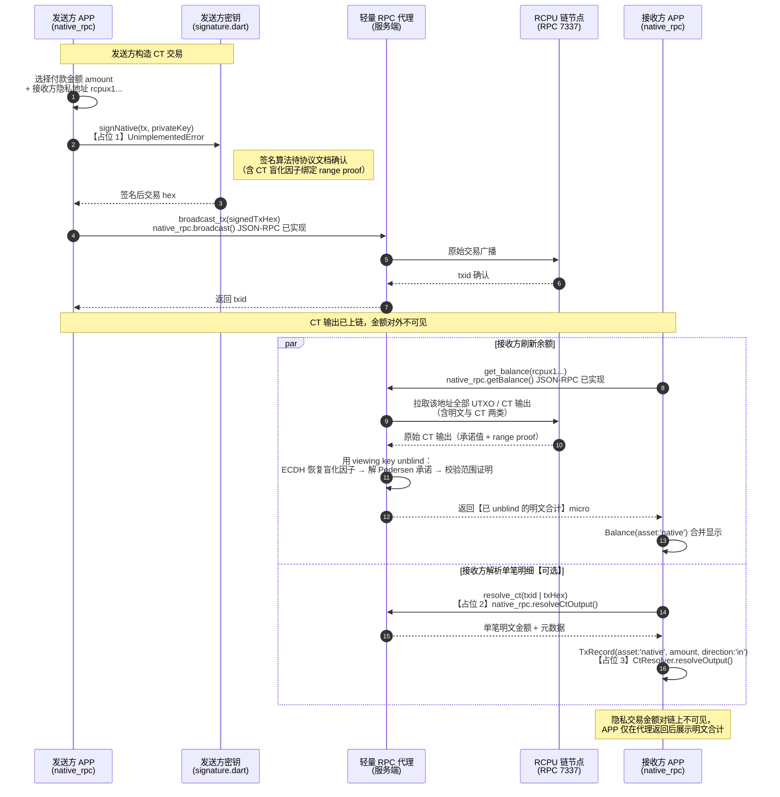

# CT Unblind 数据流时序图（发送方 → 接收方 → 代理）

> 说明：本图描述 RCPU 机密交易（CT）从发送方构造到接收方恢复金额的完整链路，
> 标注当前工程的**占位点**（`UnimplementedError`）与**轻量代理调用位置**。
> 协议细节（Path C 派生、viewing key 形态、证明格式）以官方文档为准，见
> `docs/ct-confirmation-table.md` 的 C1-C5。

## 关键链路与工程落点

| 步骤 | 参与者 | 工程调用 | 状态 |
| --- | --- | --- | --- |
| ① 构造并签名 CT 交易 | S → SC | `signature.dart → signNative()` | 【占位 1】`UnimplementedError('原生签名算法待协议文档确认')` |
| ② 广播交易 | S → P | `native_rpc.dart → broadcast()` | ✅ 已实现（JSON-RPC `broadcast_tx`） |
| ③ 查询余额（代理 unblind） | R → P | `native_rpc.dart → getBalance()` | ✅ 已实现（JSON-RPC `get_balance`），unblind 由代理完成 |
| ④ 单笔明细解析（可选） | R → P | `native_rpc.dart → resolveCtOutput()` | 【占位 2】`UnimplementedError('CT unblind 待接入代理或本地实现')` |
| ⑤ 本地 unblind 储备 | R 本地 | `utils/ct_resolver.dart → resolveOutput(txHex, ownAddress, unblindingKey)` | 【占位 3】`UnimplementedError('CT unblind 待接入：代理优先，本地储备')` |

## 代理侧 unblind 必须完成的三件事

1. **恢复盲化因子**：发送方 ECDH（发送方私钥 × 接收方公开密钥）生成一次性 nonce 与盲化因子，
   接收方（或持 viewing key 的代理）用对应私钥完成 ECDH 反向恢复；
2. **解 Pedersen 承诺**：`commitment = r*G + v*H`，已知 r 后解出金额 v；
3. **校验范围证明**：确认 v 在合法区间（如 `0 ≤ v < 2^64`），防止负值伪造。

> 上述三步属于链上 CT 协议实现，APP 侧**不重复实现**，统一收敛到代理；
> 代理不可用时（桥 API / 代理宕机），APP 按 `docs/ct-integration.md` 第 4 节降级
> 为「隐私交易（金额保密）」展示，不阻塞明文 RCPU 收付与 wRCPU 桥操作。

## 发送方流程中的隐私要点

- 收款二维码默认 `rcpux1...`（隐私），PMT 协议建议 `rcpu:rcpux1xxx?amount=1.5`；
- 发送方不接触盲化因子原始值——由签名库（signature.dart 替换实现后）在构造交易时
  一并生成并随交易附加证明；
- 私钥（含 CT spending key）全程驻留内存，不落盘，由 `secure_store` 加密保管。